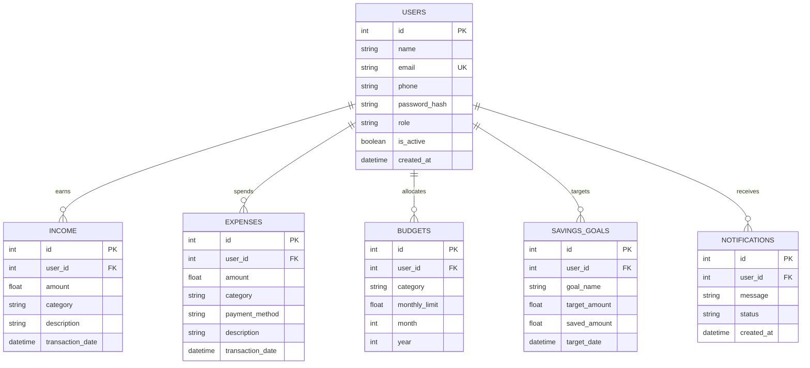

# Smart Personal Finance & Expense Tracker

A full-stack, production-ready personal finance management system engineered with **Python FastAPI**, **React.js (Vite)**, and **PostgreSQL**. The application features an interactive Glassmorphism UI, real-time analytics dashboards, AI-powered receipt scanning (OCR simulation), spending predictions, PDF/Excel/CSV exports, budget overspending alerts, savings milestone tracking, and a full System Admin Portal.

---

## 🌟 Key Features

### 🔐 Authentication & Role Management
- JWT access and refresh token management with bcrypt password hashing.
- Role-based Access Control (RBAC): `User` and `Admin` permissions.
- Account profile controls, security settings, and password updates.

### 📊 Dashboard & Data Visualization
- Interactive Chart.js charts: Income vs. Expense multi-axis trends and expenditure category breakdown.
- Financial Health Score (0-100 algorithm) with real-time risk classification.
- Quick indicators for current net balance, remaining category budgets, and monthly totals.

### 💵 Income & Expense Management
- Comprehensive CRUD operations with category tagging and payment method classification.
- Multi-criteria filtering, multi-column sorting, and real-time search across transactions.
- **AI Receipt Scanner (OCR)**: Drag-and-drop receipt uploader that automatically extracts totals, merchants, and dates.

### 🎯 Budgets & Savings Goals
- Category-level spending limits with animated progress bars and overspending alerts.
- Visual savings milestones with quick deposit actions and achievement notifications.

### 📈 Reports & AI Advisor
- Automated report export in **PDF** (formatted document), **Excel** (`.xlsx`), and **CSV**.
- Machine learning moving-average spending projections and automated savings tips.

### 🛡 System Admin Portal
- Platform metrics tracking (total users, active budgets, transaction logs).
- Account administrative controls: view user registry, block/unblock accounts, and delete users.

---

## 🛠 Tech Stack

- **Backend**: Python 3.12, FastAPI, SQLAlchemy ORM, Pydantic v2, PyJWT, Passlib, ReportLab, OpenPyXL.
- **Frontend**: React 18, React Router v6, Axios, Chart.js, Lucide Icons, Vanilla CSS Glassmorphism Design System.
- **Database**: PostgreSQL 16 (with SQLite zero-config fallback for quick local execution).
- **DevOps**: Docker, Docker Compose, Nginx.

---

## 🚀 Quick Start Guide

### Option 1: Local Setup (SQLite Zero-Config Fallback)

#### 1. Start FastAPI Backend
```bash
cd backend
python -m venv venv
# On Windows:
venv\Scripts\activate
# On Linux/macOS:
source venv/bin/activate

pip install -r requirements.txt
uvicorn app.main:app --reload --port 8000
```
- API Documentation (Swagger): `http://127.0.0.1:8000/docs`

#### 2. Start React Frontend
```bash
cd frontend
npm install
npm run dev
```
- Web App URL: `http://localhost:5173`

---

### Option 2: Docker Compose (PostgreSQL Production Stack)

Run the entire application stack (Postgres + FastAPI + Nginx React Frontend) with a single command:

```bash
docker-compose up --build
```
- Web Application: `http://localhost:3000`
- FastAPI Backend: `http://localhost:8000/docs`

---

## 🗄 Database ER Diagram (Mermaid)


"# Project-1-Smart-finance-tracker" 
